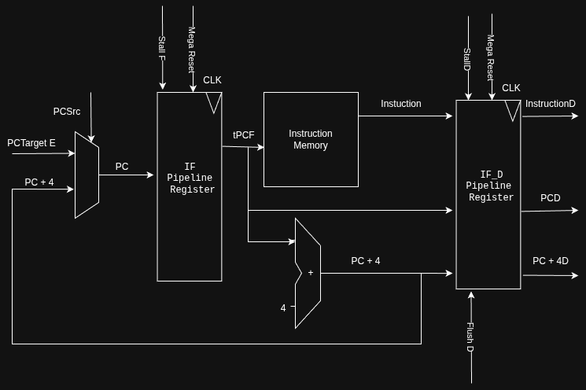
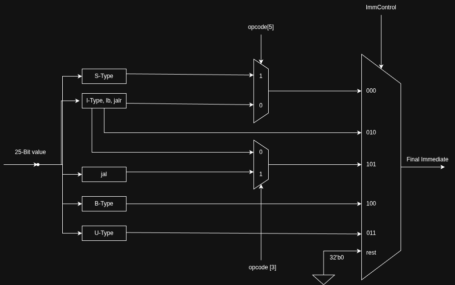
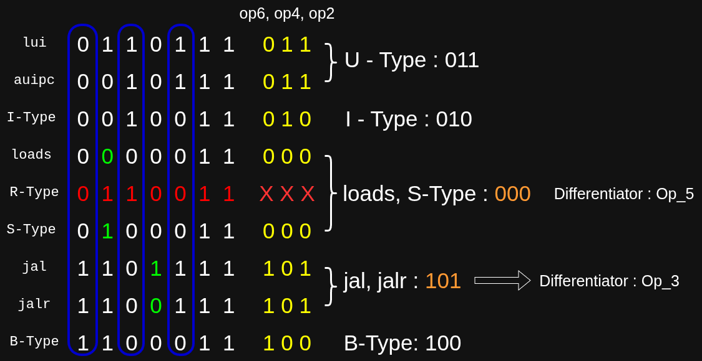
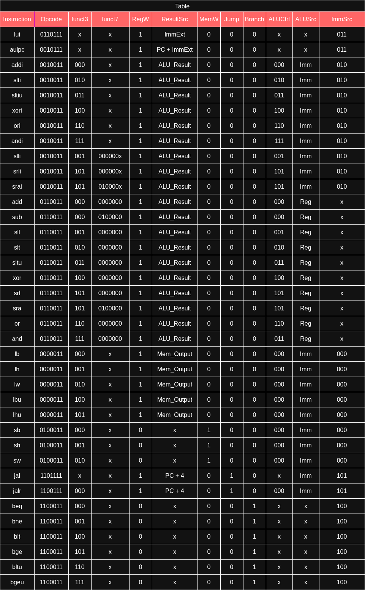
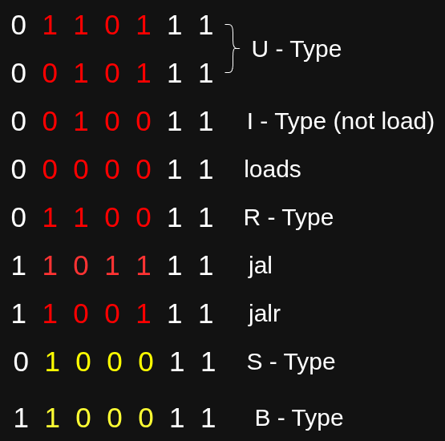
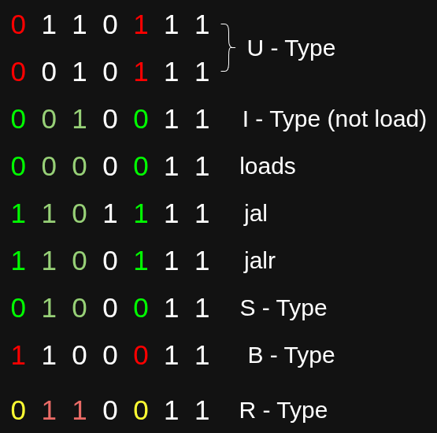
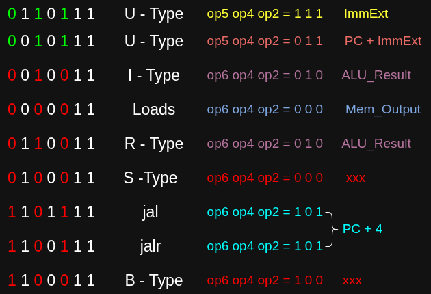
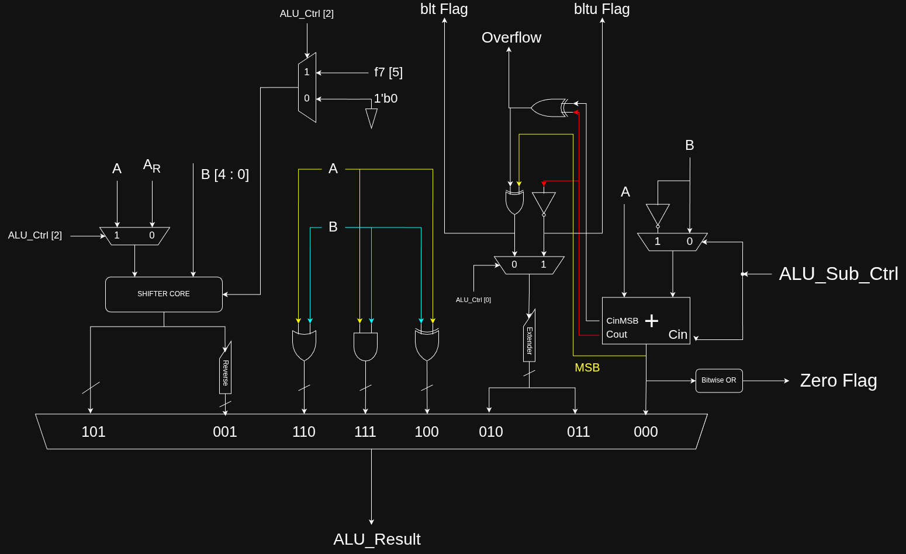

# RV32I 5-Stage Pipelined Processor Core
This is an individual project, that implements an FPGA synthesizable, 32-bit RISC-V RV32I processor core. The processor is split into the classical 5 stages, Instruction Fetch, Decode, Execute, Memory and Writeback stage. In addition it includes a Hazard Unit, responsible for handling both control and data hazards. It follows the Harvard Architecture, wherein the Data Memory and Instruction Memory are Isolated. The maximum speed achieved thus far is around 53MHz. Execution accuracy was determined with the help of Icarus and GTKWave. Timing constraints and resource utilization were analyzed with the help of Vivado.  
## Features
1. Supports RV32I User Level Operations.
2. 5-stage Pipelined.
3. Hazard Detection and Data Forwarding between stages.
## Processor Specifications
Will write this later. 

## Pipelined Architecture
The processor mainly contains the following major subsystems:
- IF
- ID
- EX
- MEM
- WB
- Hazard Unit.

I shall try my best to explain the RTL so written in as concise and detailed manner as possible. It should be kept in mind, however, this project was written at an early stage of learning Verilog/SystemVerilog. Some sections of code are highly optimized, whereas others are written at gate level.

### Instruction Fetch Stage
This stage deals with fetching the instructions provided by user. As mentioned earlier, the processor follows the Harvard Architecture, thus Instruction Memory is separated from Data Memory. The memory has a capacity to store 1024 compiled and assembled instructions. The instructions, in this project, are written in the file "program.mem", in the form of Hexadecimal numbers of size 32bits. If the program written is less than the maximum capacity, the instructions are filled automatically with 0x00000000. 

This entire stage is encapsulated under the module "IF". The module contains the pipeline register, responsible for stalling instruction fetch as well.
The register reads between PC+4 and PCTarget. The 2 data lines are chosen via a MUX. Since the processor has no Branch prediction, whether or not to branch is realised only in the EX stage. If the processor realizes it needs to branch, it immediately chooses PCTarget. Otherwise, PC+4 data line is chosen. The choice then is read into the pipeline register. If it is not stalled, on the next clock cycle, this data is forwarded to the other components of the IF stage. 
```verilog
wire [31:0]tPCPlus4, t0, tPCF, meminput;
assign t0 = PCSrc ? PCTargetE : tPCPlus4;
Bit32PIPORegister Reg_F(.write(t0), .Load_cmd(~stallF), .CLK(CLK), .Flush(MegaResetIF), .read(tPCF)); //was 1'b1
```
Wire t0 carries the choice of the MUX, into the pipeline register, which then, reads that on the next cycle to tPCF. tPCF carries the address at which the requested program exists. 

NOTE:
The instruction memory is word addressed! Thus in program.mem, the first line of instruction is at location 0, then 4 then 8 and so on. Now, it is a good practice as a designer to keep in mind Murphy's law:

**"That which CAN go wrong WILL go WRONG".**

Thus, it was imperative to assume that the location carried by tPCF may not always be Word aligned! Hence the next piece of processing was done:
```verilog
genvar i;
generate
    for (i = 0; i < 30 ; i = i + 1) begin
        assign meminput[i] = tPCF[i + 2];        
    end
    assign meminput[31] = 1'b0;
    assign meminput[30] = 1'b0;
endgenerate
```
In this, the address given is first right shifted by 2 places, instantly making it a multiple of 4. Hence, the instruction memory will always recieve a valid, though not necessarily correct,  address. The job of the processor is not to decide whether the location provided is semantically correct as intended by user or not. It's supposed to simply keep processing the instructions that are provided to it. 

PC + 4 is calculated within this stage and directly sent back to the MUX at the start. The memory unit outputs the 32 bit instruction recieved. and sends it to IF_D pipeline register, to be forwarded to Decode Stage in the subsequent clock cycle. 
3 things are forwarded to Decode Stage not necessarily to be used by it:
- Instruction Fetched
- PC associated with Instruction fetched
- PC+4 a.k.a the PC of next instruction.


  
### Decode Stage
The decode stage consists of 3 sub units. This stage is accountable for generating the correct control signals, preparing required data and essentially making sense of the 32-bit instruction provided by the Fetch stage. It also houses the Register File, which is a 32 x 32 grid of Flip Flops. 

The 3 subsystems in this stage are:
- Register File
- Extend Unit
- Control Unit

#### 1.Extend Unit
This unit is responsible for decoding the instruction and inferring the immediate value intended by instruction. It should be noted that every instruction does not necessarily have a immediate value. Yet, the Extend Unit, being largely combinational in nature, always provides an interpretation. It is up to the subsequent stages to decide whether or not to use the interpretted immediate value.

The Extend Unit takes as input 3 control signals:
- ImmControl (3 bit)
- op_5 (2nd Bit of opcode from MSB)
- op_3 (4th bit of opcode from MSB)

Aside from these, it has been noticed that all the instruction types within the RV32I ISA, will, if they do, have their immediate field present within the first 25 bits of the instruction in some form or the other. These 25 bits are then parellely decoded for each instruction type. They are then passed through the MUX layer, with the appropriate control signals. The output is a 32 bit immediate value. 

```verilog
wire [31:0]U, Ilbjalr, S, jal, B, t0, t1;
assign U = {immediate[24:5], 12'b0};
assign Ilbjalr = {{20{immediate[24]}}, immediate[24:13]};
assign S = {{20{immediate[24]}}, immediate[24:18], immediate[4:0]};
assign jal = {{11{immediate[24]}}, immediate[24], immediate[12:5], immediate[13], immediate[23:14], 1'b0};
assign B = {{19{immediate[24]}}, immediate[24], immediate[0], immediate[23:18], immediate[4:1], 1'b0};
```
In the decoding of immediate values for each instruction type, no specific logic has been used. As specified, by the ISA, the immediate has been unscrambled. The logical reasoning is involved in the MUX process. 
```text
The distinct opcodes for each instruction type are as follows:
1. U-Type
    - lui    : 0_(1)_1_(0)_111
    - auipic : 0_(0)_1_(0)_111
2. I-Type
    - all    : 0_(0)_1_(0)_011
    - loads  : 0_(0)_0_(0)_011
3. R-Type
    - all    : 0_(1)_1_(0)_011
4. S-Type
    - all    : 0_(1)_0_(0)_011
5. J-Type
    - jal    : 1_(1)_0_(1)_111
    - jalr   : 1_(1)_0_(0)_111
6. B-Type
    - all    : 1_(1)_0_(0)_011
```
The bits in brackets are the ones being passed into the Extend Unit as control signals. The Extend Unit logic can be understood by the diagram below: 



I-Type, lb, and jal instructions use the same immediate encoding pattern. Thus they are all routed through a common "decoder" unit. As is seen in the diagram, the 25 bits are processed parellely and in a combinational manner. MUX decides which output to use. 

##### Control Mechanism:
The control signals provided to the Extend Unit has been created, solely by inspecting the opcodes of the respective, extensions. It can be better understood by looking at the diagram provided below: 



The Opcode is indexed as MSB: Op_6 to LSB: Op_0. The differentiator bits have been highlighted in green for readability. R-Type doesn't have an immediate field and hence doesn't require the output of Extend Unit. Hence, it has been ignored. 

The logic I used, relies mostly on re using the opcode bits. This reduces the resources dedicated to any calculation circuit. However it does come at the cost of a larger fanout of opcode bits. 

#### 2.Register File
Before moving on I want to shed light on the fact, that this project was made as my first substantial Verilog project. It was designed as I learnt the language. Thus, much of the code, focuses on underlying hardware clarity rather than on the behavorial constructs of the Verilog language. 

That being said, the register file has been instantiated as 32 lines of 32-bit registers. For the purpose of writing a combinational decoder circuit has been implemented that decides which register should be open for writing. The input data is visible to all registers. Similarly a reader tree combinational circuit has been implemented using 2to1 Multiplexers to decide which register to read from. 2 such units are instantiated to read RS1 and RS2 simultaneously. 

The register file inputs 3 5-bit adresses, 32-bit write data, write enable signal, reset signal and outputs, the data of RS1 and RS2 simultaneously. **It writes on the negative edge of clock. This allows signals to stabilize, and also write to complete without having to stall the pipeline.**

#### 3.Control Unit
The control unit is the heart of the processor. The signals it generates, conduct the movement of the Datapath and are responsible for controlling computationa and all the important functions a processor will need to perform. 

The control Unit outputs the following signals:
- RegW
- MemW
- Jump
- Branch
- ALUSrc
- ALU_Sub_Ctrl
- ALU_Ctrl
- opcode_5
- opcode_3
- funct_7C
 
The entire logic table is summarised below: 



ALU_Ctrl is fairly simple, it outputs funct3 of the opcode directly, with the exception of load/store instructions, where 000 is generated. 

Within the Control Unit, the first and most important internal signal generated is Decider: 
```verilog
assign Decider = 
    (opcode == 7'b0110111) |
    (opcode == 7'b0010111) |
    (opcode == 7'b0010011) |
    (opcode == 7'b0110011) |
    (opcode == 7'b0000011) |
    (opcode == 7'b0100011) |
    (opcode == 7'b1101111) |
    (opcode == 7'b1100111) |
    (opcode == 7'b1100011);
```
It is a prelimimary check, to decide whether or not, the instruction type is supported, by the ISA. If not, many of the crucial signals are zeroed. Crucial signals are those, which are used to change contents of data. If Data Write to both Register File and Data Memory is restricted, and branch and jump is not allowed, we have effectively created a nop. Such an instruction doesn't do anything useful, thus any wrong/gibberish/not supported instruction will have no impact on data integrity and working of processor. 

We shall now look at the signals and the logic used to generate them: 

For all the control Signals, I analyzed the opcode and figured out common patterns. Almost all the signals are generated by performing simple operations on select opcode bits itself.

##### 1.RegW:


```verilog
assign RegW = Decider ? (~opcode[5] | opcode[4] | opcode[3] | opcode[2]) : 1'b0;
```

With the exception of branch and store type instructions, every other instruction performs Register write. The above logic perfectly performs that. 

The opcodes for S-Type and B-Type instructions are :
```text
B- Type: 1 1 0 0 0 1 1
S- Type: 0 1 0 0 0 1 1
```
If we analyze all the opcode bits, it is clear that only S and B-Type instructions have the pattern (1 0 0 0) for opcode[5] to opcode[2].



The logic defined, works fine in producing 0 for 1000 combination. If Decider is 0 => the opcode is not supported. The processor protects it's register states from such malicious instructions, by making RegW = 0 for this. 

##### 2.MemW:

Only S-Type instructions require writing to Memory. Thus, once again their opcodes were analyzed and the following logic was deduced:

```verilog
assign MemW = Decider ? (~opcode[6] & opcode[5] & ~opcode[4] & ~opcode[3] & ~opcode[2]) : 1'b0;
```

This is fairly simple to understand. For RV32I ISA the last 2 bits of the opcode is (11) for ALL instructions. Thus only the first 5 bits are of significance. If the instruction is malicious, Decider = 0, and control unit turns off MemW, avoiding data corruption. 

##### 3.Jump:

Once again only J-type instructions will activate Jump signal. Thus the following logic was inferred: 

```verilog
assign Jump = Decider ? (opcode[6] & opcode[2]) : 1'b0;
```

It would be advisable for users to refer to the list of opcodes under the RegW section. Here too, if the instruction is malicious, the processor protects it's flow by clamping Jump signal to 0.
I noticed that opcode[6] and opcode[2] are (11) only for jal and jalr. Thus the logic became fairly simple, involving only 2 bits. 

##### 4.Branch:

Again, branching is performed **ONLY** by B - Type instrcutions. The logic hence used is:

```verilog
assign Branch = Decider ? (opcode[6] & ~opcode[2]) : 1'b0;
```

Again, I noticed that opcode[6] and opcode[2] hold the pattern (10) only for B-Type instructions, making the logic fairly simple. 

##### 5.ALUCtrl:
ALUCtrl, is a 3 bit signal sent to the ALU in the EX stage. It decides which result of the ALU is required by the instruction. ALU_Ctrl is directly assigned funct3, except for loads and stores where, irrespective of funct3 addition is required. Thus there 000 is generated.

How each ALU_Ctrl signal affects the ALU, will be discussed later. 

```verilog
wire [2:0] tALU;
assign tALU = (~opcode[6] & ~opcode[4] & ~opcode[3] & ~opcode[2]) ? 3'b000 : funct3;
assign ALU_Control = Decider ? tALU : 3'b000;
```

Once again refer above for opcodes. For load and store, it specifically generates 000, while for other instructions it outputs funct3. 

##### 6.ALU Source:

```verilog
assign ALUSrc = ~(opcode[6] ^ opcode[2]) & ~(opcode[5] & opcode[4]);
```

Only loads, I-Type, S-Type and J-Type require Immediate. The logic is summarised below:



The opcode[6] and opcode[2] of the target instructions are same. However R-Type instructions were also fitting into this definition. Thus the extra check of opcode[5] and opcode[4] was added, which succesfully removes R-Type from the definition. 

When ALUSrc = 1 => The 2nd operand going into ALU is an immediate. 

##### 7.ResultSrc:
This control signal travels with the instruction to WriteBack stage. It dictates which data will be written to the register file if any.

The logic implemented is as follows:

```verilog
wire [2:0]w1, w2;
assign w1 = {opcode[5], opcode[4], opcode[2]};
assign w2 = {opcode[6], opcode[4], opcode[2]};

assign ResultSrc = (~opcode[6] & opcode[4] & opcode[2]) ? w1 : w2;
```

From the table of control signals it is obvious, that for the RV32I ISA, when writing back to the register file, we have in cumulation 5 results that will be used:
- ImmExt (lui)
- PC + ImmExt
- PC + 4
- ALU Result
- Memory_Result

Thus the write back MUX will require 5 distinct signals. 
It is clear that ImmExt, is required ONLY by lui. Thus first we check for lui. It was observed that only U - Type instructions have opcode[6], opcode[4], opcode[2] in the pattern (011). 
Then, w1 = (111) which is assigned to ImmExt. 

The logic can be better understood from the image below:



### Execute Stage 
This stage consists of ALU and a separate unit to perform additions on PC. Since program counter will always undergo an addition operation, under appropriate instructions, it is prudent to assign a separate execution unit that only performs addition on PC. This helps take the load off the ALU and ensure that ALU is concerned only with operations on registers and Immediate values. 

#### Arithmetic Logical Unit:
The ALU fundamentally performs the following computations:
1. ADD
2. XOR
3. OR
4. AND
5. SHIFTING

The truly independent computations are AND, XOR and OR. The rest share resources and with minor alterations to input and output produce a total of 9 different results. The results are computed in parallel, the results being chosen eventually by a MUX. The results are used, to also set flags, mostly used by B-Type instructions.

The overview of the ALU architecture is as shown below:



The ALU takes as input, RS1 and RS2, the two 32-bit operands. The control signals are, 3-bit ALU_Ctrl, 1-bit funct7 [5] and 1-bit ALU_Sub_Ctrl. 
The results and their corresponding ALU_Ctrl are listed below: 
- 000 : Add/Sub
- 011 : SLTU
- 010 : SLT
- 100 : XOR
- 111 : AND
- 110 : OR
- 101 : SRL/SRLi/SRA/SRAi/SLL/SLLi
- 001 : 

Addition and subtraction pass through the same adder unit. In case of subtraction, we do 2's complement addition, by inverting and adding 1. Since, only for subtraction, Cin = 1, ALU_Sub_Ctrl controls both the operand and Cin. 
From the adder unit, we get many useful results. By performing a bitwise OR on the 32-bit result, we get the zero flag. Similarly, many of the results are carried forward to SLT/U unit. 
